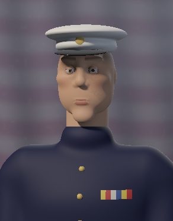

# Echoes of Anarchy

**A first-person bodycam thriller set on Purge night, in which every model, texture, sound and voice is generated by code.**

You play Daniel Reyes, a paramedic and ex-Marine whose ambulance is rammed minutes after the annual twelve-hour
"Night of Renewal" begins. To reach his twelve-year-old daughter he has to cross a city where every crime is legal. A
masked crew, the Smilers, are livestreaming the night. They have cloned his daughter's voice, and they want an audience
for what a Marine will do to get her back.

`Unity 6 (6000.6)` · `URP · Forward+` · `C#` · `HLSL` · `Input System` · `AI Navigation`

> **Status:** a playable vertical slice of about 15 minutes (the ambulance cold open through the school-door
> cliffhanger) that is being shaped into a tight, roughly 30-minute portfolio game.



*The photo taped to the school door is not a texture file. A small ray marcher in C# renders it at load time from a
signed-distance bust lit like a studio portrait, and the game then ages it as a print.*

---

## Why it's interesting

### Zero imported assets
The repository contains no models, textures, audio files or fonts made in other tools. Everything you see and hear is
built by C# generators and HLSL shaders when the scene is built or when the game loads:

| What | How |
|---|---|
| **City** | Rule-based district generator: buildings with facades, windows and roofs, streets, props, a gas station and alleys, all laid out from seeded randomness. A runtime NavMesh bakes over the result |
| **Materials** | PBR texture "recipes" (albedo, normal, mask) synthesised from layered noise (asphalt, brick, concrete, metal, fabric weaves, skin pores), cached as PNGs |
| **Characters** | Skinned humanoids lofted from superellipse cross-sections, with garment layers (hems, cuffs, pockets, zips, lapels), sculpted heads with lidded eyes, lips, ears and stubble, four-fingered hands, and masks (LED grin, pig, porcelain angel). Each has one skinned mesh and 16 bones |
| **Animation** | Fully procedural: gait-phase locomotion, idle breathing and weight shift, pose blending (aim, surrender, kneel, cower, seated), head look, two-bone IK for feet and hands (the driver's hands follow a turning steering wheel), and ragdolls |
| **Audio** | A DSP synthesis library: gunshots modelled as a Friedlander blast wave clipped by a body-camera mic with street reflections, engines, sirens, impacts, a heartbeat and tinnitus. Sounds render in parallel at load, and 3D playback adds speed-of-sound delay, air absorption and occlusion |
| **Voices** | Dialogue is "babble" built from per-speaker synthesised syllables, timed to the words of each English line, and passed through radio, phone or room channels. Subtitles are in English or Turkish |
| **Images** | A 5×7 pixel font painted as spray paint (drips, overspray) or stencil; blood decals; the ray-traced portrait above |

### Systems
- **Bodycam presentation:** a chest-mounted camera with lean, recoil and subtle handheld noise, plus a post-processing
  profile built in code with stress, exposure and tape-glitch hooks. The HUD has a REC/timestamp overlay, a GPS
  heading line and objective lines; there are no waypoint markers.
- **Combat and stealth:** hitboxes per bone, damage multipliers, blood that scales with distance, faint damage numbers,
  a pistol with visible magazine reloads, thrown bottles for distraction, and pistol-whip or punch melee.
- **AI:** a perception model (sight scaled by how lit the player is, plus hearing on a noise bus) drives a finite
  state machine with morale. Enemies surrender or flee, can be spared or executed, call reinforcements, and run a
  scripted "herding" chase mode in which they shoot to miss until provoked.
- **Story systems:**
  - A hidden moral **Ledger** records everything the bodycam sees and feeds the endings.
  - **StoryState** keeps facts that later scenes react to: if you left your partner, the livestream chat mocks you
    for it.
  - **Checkpoints** restore the world as it was, not just the player's position.
- **Narrative direction:** a dialogue director handles conversations, radio traffic, phone calls and voicemail. The
  sequences include a cold open in a moving ambulance, a crash, a moral choice, a stealth-or-fight gas station with
  reinforcement waves, a chase you can only escape by crawling under a garage shutter, and a livestream hijacking the
  player's own camera.

---

## How it was made

I designed and directed this game, and I built it together with AI coding agents (Claude Code and Codex). I treated
them like a small engineering team working to a process I set up:

- **A living design document** (`docs/DESIGN.md`) records every decision I made, the reason behind it, and the phase
  plan with each phase's status.
- **A handoff contract** (`AGENTS.md`) is written so that an agent with no memory of earlier sessions can continue from
  the repository alone. It holds the code map, the conventions and the gotchas learned the hard way.
- **Phase-by-phase delivery:** each phase ends with test instructions, I playtest it, and my feedback becomes the next
  iteration. The design doc and `docs/CHANGELOG.md` keep that feedback.
- **A hard creative constraint:** no imported assets at all. Every look and every sound has to be described as an
  algorithm, which forced the procedural pipeline described above.
- **Verification outside the editor:**
  - Code is compile-checked headlessly.
  - Audio recipes are rendered to WAV offline and checked for NaN, silence and levels.
  - The portrait renderer is run in a plain .NET console app to inspect its output.

My role was game design, story, art direction, playtesting and quality control: deciding what the game should feel
like, testing every build, and rejecting what didn't work. Some examples: "the gunshot sounds like a drum", "the camera
in the cab is too low", "my friend didn't understand what the livestream was". The agents implemented it under that
direction.

---

## Running it

1. Install **Unity 6000.6.2f1** and open the project.
2. Run **Tools › Echoes › Build Harlow District**. This generates the textures, materials and the whole scene; the
   `Generated/` and `Scenes/` folders are build outputs and are not in the repository.
3. Open `Assets/_Game/Scenes/HarlowDistrict.unity` and press Play. The demo starts in the ambulance.

To make a shareable Windows build, use **Tools › Echoes › Build Demo (Windows)**.

### Controls
| | |
|---|---|
| Move / look | WASD / mouse |
| Sprint / crouch / jump | Shift / C (or hold Ctrl) / Space |
| Fire / aim / reload | Left click / right click / R |
| Use, or punch | F |
| Throw a bottle | G |
| Lean | Q / E |
| Holster / flashlight / med kit | X / T / H |
| Damage numbers / subtitle language | F2 / F3 |
| Quit | Hold Esc |

---

## Project layout

```
Assets/_Game/Scripts
├── Core        clock, settings, Ledger, StoryState, checkpoints
├── Player      input, controller, bodycam rig, flashlight
├── Rendering   post-processing, procedural textures, fonts, fabric maps, particles, the portrait ray marcher
├── World       district / building / prop / vehicle generators, mesh builder
├── Audio       DSP and the synthesis library, the audio manager, 3D emitters
├── Combat      health and hitboxes, the pistol, melee, throwing, impact FX
├── AI          humanoid builder, skinned body builder, masks, procedural animator, perception, NPC brain
├── Narrative   dialogue director, lines (EN/TR), story sequences
├── UI          bodycam HUD, livestream overlay, damage numbers
└── Editor      scene builder, material library, build pipeline
```

About 18,000 lines of C#, plus two HLSL shaders.

---

*The premise of one night a year when all crime is legal is a nod to the* The Purge *films. The setting, characters
and story are original.*
